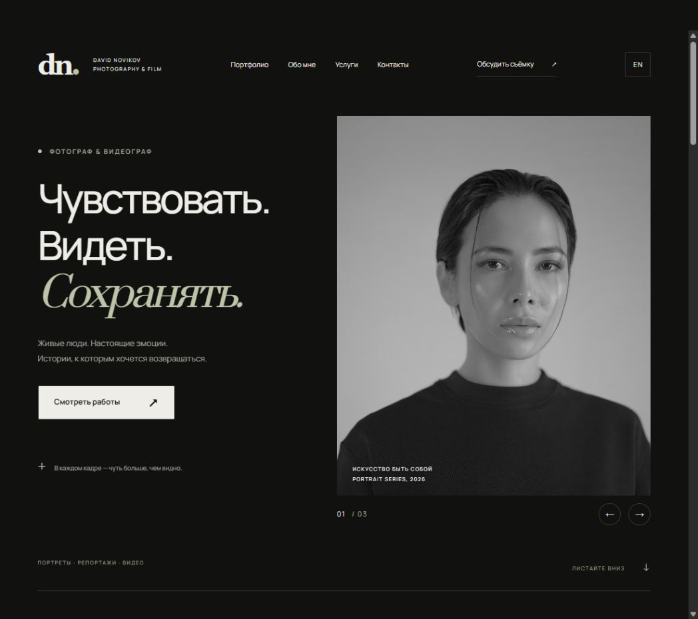
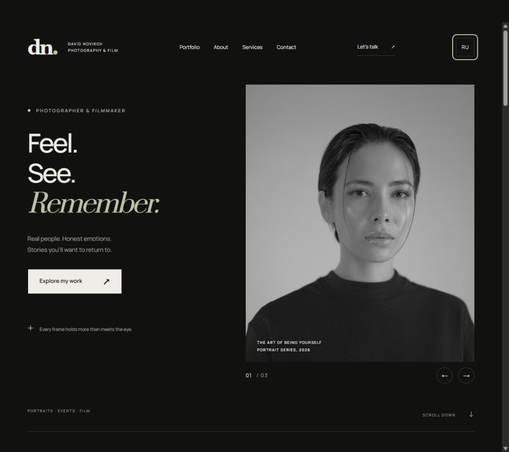

# Frame — Photography & Film Portfolio

Адаптивное портфолио фотографа и видеографа на **HTML, CSS и  JavaScript**. Минималистичный тёмный дизайн, галерея фотографий и видео, переключение RU / EN и загрузка новых работ через Supabase.

Проект работает без фреймворка, сборщика и установки npm-зависимостей. Цвета, типографика, отступы и сетки вынесены в CSS-переменные, чтобы сайт можно было адаптировать под собственный визуальный стиль.

Адрес GitHub Pages после успешной публикации: **[daflewx.github.io/my_web_site](https://daflewx.github.io/my_web_site/)**.



> Проект представляет собой готовый к настройке каркас. Имя автора, тексты, цены, фотографии и социальные ссылки демонстрационные. Публичная часть работает без Supabase; для входа администратора и загрузки файлов необходимо подключить собственный проект Supabase.

## Содержание

- [Возможности](#возможности)
- [Технологии](#технологии)
- [Локальный запуск](#локальный-запуск)
- [Структура проекта](#структура-проекта)
- [Подключение Supabase](#подключение-supabase)
- [Замена фотографий и видео](#замена-фотографий-и-видео)
- [Языки интерфейса](#языки-интерфейса)
- [Быстрая смена дизайна](#быстрая-смена-дизайна)
- [Контакты и размещение сайта](#контакты-и-размещение-сайта)
- [Проверка](#проверка)
- [Публикация репозитория на GitHub](#публикация-репозитория-на-github)
- [Текущие ограничения](#текущие-ограничения)

## Возможности

- Hero-секция со слайдером избранных фотографий.
- Адаптивная CSS Grid-галерея и фильтрация по категориям без перезагрузки.
- Полноэкранный просмотр фотографий и MP4-видео через PhotoSwipe.
- Плавное появление секций и поддержка `prefers-reduced-motion`.
- Ленивая загрузка изображений и видео; пауза видео вне экрана.
- Разделы «Обо мне», услуги, цены и контактная форма.
- Русский и английский интерфейс с сохранением выбранного языка.
- Админка с авторизацией через Supabase Auth и проверкой прав через RLS.
- Загрузка медиа, создание WebP-превью фотографий и немедленное добавление карточки в галерею.
- Комментарии в HTML с инструкциями по замене фотографий, видео и обложек.

## Технологии

| Задача | Решение |
| --- | --- |
| Разметка | HTML5 |
| Стили | CSS3, Custom Properties, Grid, Flexbox |
| Логика | JavaScript ES-модули |
| Анимации | AOS 2.3.4 |
| Слайдер | Swiper 12.0.3 |
| Лайтбокс | PhotoSwipe 5.4.4 |
| Авторизация, БД и файлы | Supabase Auth, PostgreSQL, Storage; JS SDK 2.57.4 |
| Локальный сервер и тесты | Встроенные модули Node.js |

Библиотеки и шрифты подключены по CDN. Для демонстрационных медиа и внешних интеграций требуется интернет.

## Локальный запуск

Нужен Node.js 20+; npm-зависимости устанавливать не нужно.

Скачайте репозиторий или клонируйте его:

```sh
git clone https://github.com/Daflewx/my_web_site.git
cd my_web_site
```

Запустите сервер:

```sh
npm run dev
```

Откройте [сайт](http://localhost:5173) или [админку](http://localhost:5173/admin).

Если npm недоступен, запустите сервер напрямую:

```sh
node scripts/server.js
```

Через `file://` ES-модули работать не будут. Для другого порта задайте переменную окружения `PORT`. Остановить сервер можно сочетанием `Ctrl+C`.

### Запуск из VS Code

Откройте папку проекта в VS Code и нажмите **Ctrl+Shift+B** — задача «Запустить сайт» выполнит `node scripts/server.js` в терминале. После появления `Portfolio: http://localhost:5173` откройте этот адрес в браузере. Node.js должен быть установлен и доступен в терминале VS Code.

**Ссылка `localhost` работает только пока сервер запущен на вашем компьютере.** После остановки процесса или перезагрузки компьютера запустите задачу заново. Открытая вкладка браузера и загрузка кода на GitHub не запускают локальный сервер.

Если браузер показывает `ERR_CONNECTION_REFUSED`, проверьте терминал и запустите сервер. Если терминал сообщает `EADDRINUSE`, порт уже занят: не запускайте второй экземпляр, сначала проверьте уже работающий сайт. Если команда `node` не найдена, установите Node.js и перезапустите VS Code.

### Как открыть сайт на телефоне

1. Подключите телефон к домашней Wi-Fi сети того же роутера, к которому подключён компьютер (компьютер может быть подключён кабелем).
2. Остановите предыдущий сервер через `Ctrl+C`, если он уже занимает порт 5173.
3. В VS Code выберите **Терминал → Выполнить задачу → Запустить сайт для телефона (Wi-Fi)** или выполните:

   ```sh
   node scripts/server.js --host
   ```

   Эквивалентная команда npm: `npm run dev:lan`.

4. В терминале появится `Phone (same network): http://192.168.…:5173`. Откройте адрес домашнего сетевого адаптера в браузере телефона. При наличии VPN или виртуальных адаптеров адресов может быть несколько.
5. Оставляйте компьютер включённым и сервер запущенным. `localhost` на телефоне указывает на телефон, поэтому используйте IP компьютера.

Если телефон не подключается, проверьте общую сеть и отсутствие изоляции клиентов в гостевой Wi-Fi сети. При запросе брандмауэра Windows разрешите Node.js в вашей частной домашней сети; отключать брандмауэр целиком не требуется. После смены сети IP компьютера может измениться — смотрите свежий адрес в терминале.

Режим `--host` предназначен для просмотра в локальной сети. Для открытия с любого телефона через мобильный интернет разместите сайт на статическом хостинге с HTTPS. Админку с реальными учётными данными используйте на HTTPS или локально на компьютере; некоторые браузерные API загрузки требуют защищённого контекста.

## Структура проекта

```text
index.html               Секции и HTML-инструкции по медиа
css/styles.css           Токены, сетки, адаптивность, reduced-motion
js/config.js             Публичные настройки Supabase и email
js/i18n.js               Переводы RU / EN и сохранение языка
js/main.js               Навигация, Swiper, AOS, контактная форма
js/gallery.js            Фильтры, PhotoSwipe, lazy-video, облачные карточки
js/media.js              Валидация файлов, размеры, WebP-превью
js/supabase.js           Ленивое подключение JS SDK
js/upload.js             Вход, проверка роли, загрузка и публикация
assets/favicon.svg       Знак сайта
assets/media/            Ваши локальные фотографии и видео
supabase/schema.sql      Таблицы, бакет, роли и политики RLS
scripts/server.js        Локальная раздача сайта с маршрутом /admin
.vscode/tasks.json       Запуск сервера из VS Code по Ctrl+Shift+B
.github/workflows/pages.yml Проверка и публикация на GitHub Pages
tests/media.test.js      Проверки ограничений медиа
preview.png              Превью русской версии для README
preview-language.png     Превью английской версии
package.json             Команды запуска и проверки
.gitignore               Исключения для Git
README.md                Описание и инструкция проекта
```

## Подключение Supabase

1. Создайте проект Supabase. В SQL Editor выполните `supabase/schema.sql`.
2. В Authentication → Users создайте пользователя с email и паролем. Публичную регистрацию можно отключить; формы регистрации на сайте нет.
3. Скопируйте UUID этого пользователя и выполните в SQL Editor:

   ```sql
   insert into public.portfolio_admins (user_id)
   values ('ВАШ-UUID') on conflict do nothing;
   ```

4. В `js/config.js` заполните `supabaseUrl` и `supabasePublishableKey` (publishable key либо legacy anon key). Это публичные значения. **Не используйте service_role, secret key и пароль в коде.**
5. Бакет по умолчанию — `portfolio`. Если меняете имя, измените его и в SQL-политиках, и в config.
6. Откройте `/admin`, войдите по email и паролю, укажите название/категорию, выберите файл и нажмите «Загрузить и опубликовать».
7. После успешной записи в БД карточка появляется первой, фильтр переключается на «Все». После перезагрузки работы читаются из таблицы `works`.

Пример конфигурации:

```js
export const config = Object.freeze({
  supabaseUrl: 'https://YOUR_PROJECT.supabase.co',
  supabasePublishableKey: 'YOUR_PUBLISHABLE_KEY',
  bucket: 'portfolio',
  contactEmail: 'hello@example.com',
});
```

Замените примеры своими публичными настройками. Проект не читает `.env`: конфигурация загружается браузером непосредственно из `js/config.js`.

Пароль проверяет Supabase Auth. Запись разрешена только UUID из `portfolio_admins`; обычный авторизованный пользователь не получает права загрузки. Бакет публичный: храните в нём только материалы, предназначенные для сайта. Публичное чтение работ предусмотрено намеренно.

Клиент проверяет тип, размер, категорию и декодирование файла. Бакет ограничивает MIME и общий размер 50 МБ, таблица — поля и владельца. Лимит фото 10 МБ дополнительно проверяется клиентом; для строгого отдельного серверного лимита фото используйте отдельный бакет или Edge Function. Для загружаемых фото автоматически создаётся WebP-превью до 1000 px. Видео использует ленивую загрузку без автоматического транскодирования: подготовьте MP4 H.264 заранее.

При ошибке записи карточки уже загруженные файлы удаляются; если сеть не позволила выполнить очистку, интерфейс просит проверить Storage. Обрыв/закрытие вкладки может оставить незавершённые объекты — периодически проверяйте бакет. Удаление/редактирование работ через интерфейс не входит в текущий каркас; это доступно в Dashboard Supabase.

## Замена фотографий и видео

- В `index.html` рядом с каждым медиа есть русские комментарии. Hero: вертикальный WebP 1600×2000; профиль: 1000×1250; карточки: превью около 800×1000 и оригинал до 2400 px; видео: MP4 H.264 1920×1080 и WebP-постер.
- Для локальных файлов используйте адреса `./assets/media/имя.webp` — так они работают и в подпапке хостинга.
- Скопируйте `<article class="work-card" data-category="portraits">…</article>` для новой карточки. Категории: `portraits`, `reportage`, `video`.
- Обновите `href` оригинала, `img src` превью, `alt`, заголовок и **реальные** `data-pswp-width`/`data-pswp-height`. Лайтбокс подключается автоматически.
- Для видео скопируйте пример с `data-media="video"`: замените `href`, `source data-src`, `poster` и размеры. `data-src` откладывает сетевую загрузку до приближения к экрану.
- Демоизображения загружаются с Unsplash, тестовое видео — CC0 flower clip из MDN. Текст и обложка видео демонстрационные. Перед публикацией замените их своими работами. Демоисточники требуют интернета.
- Hero управляется Swiper, кнопками и свайпом; автоматической смены слайдов нет. Все фоновые/галерейные видео содержат `autoplay muted loop playsinline`. При reduced-motion автоматическое проигрывание выключается; за пределами экрана видео ставятся на паузу.
- У загруженных видео пока нет генерации постера. Если он нужен, добавьте поле `poster_path` и отдельную загрузку обложки либо серверную обработку.

## Языки интерфейса

Кнопка EN / RU в шапке переключает язык без перезагрузки и сохраняет выбор в localStorage. Переводы интерфейса находятся в `js/i18n.js`. При добавлении нового текста внесите русскую строку и английский перевод в `translations`. Динамические сообщения выводите через `t()`. Авторские названия/описания из Supabase и введённые значения форм автоматически не переводятся. Цены остаются в рублях — смена языка не конвертирует валюту.

<details>
<summary>Посмотреть английскую версию</summary>



</details>

## Быстрая смена дизайна

Начните с `:root` в `css/styles.css`: `--bg`, `--surface`, `--text`, `--accent`, `--font-body`, `--font-display`, `--radius`, `--shadow`, `--section-space`, `--grid-gap`, `--container`.

`--media-filter: none` возвращает цветные фотографии. `.hero` задаёт две колонки первого экрана; `.gallery` — сетку работ; `.work-card--wide` — широкий блок; `.about-grid`, `.services-grid`, `.contact-grid` — раскладку секций. Есть брейкпоинты 1050, 760, 600 и 360 px, а также стили для сенсорных устройств. Для смены дизайна бизнес-логику JS менять не нужно.

## Контакты и размещение сайта

Впишите настоящий `contactEmail` в config и замените ссылку Telegram в HTML на свой профиль. Контактная форма создаёт `mailto:` с заполненным письмом и **не имитирует серверную отправку**. Пользователь отправляет письмо в своём почтовом клиенте. Для автоматической доставки потребуется отдельный серверный обработчик/почтовый сервис; API-ключ такого сервиса нельзя хранить во фронтенде.

Сайт можно разместить на статическом хостинге в корне домена или в подпапке. CSS, JS, favicon и ссылки на главную используют относительные пути. Для админки без настройки rewrites откройте `#admin` на главной странице, например `/my_web_site/#admin`. Локальный Node-сервер предназначен для разработки.

Для GitHub Pages добавлен workflow `.github/workflows/pages.yml`: при отправке изменений в `master` он проверяет код, выполняет тесты и публикует только `index.html`, `css`, `js` и `assets`. Настройка репозитория **Settings → Pages → Source** должна быть **GitHub Actions**. Статус публикации виден во вкладке **Actions → Deploy portfolio to GitHub Pages**. Открывайте сайт по адресу со слешем в конце: `https://daflewx.github.io/my_web_site/`.

Сайт на Pages работает по HTTPS независимо от домашней сети и включённого компьютера. Для просмотра с телефона через мобильный интернет используйте публичный адрес, а не `localhost` или `192.168.…`. Админка: [my_web_site/#admin](https://daflewx.github.io/my_web_site/#admin); маршрут `/admin` на GitHub Pages не используется. Supabase и контактный email настраиваются отдельно — публикация не заполняет их автоматически.

Для следующего обновления сохраните изменения, сделайте commit и push в `master`, затем дождитесь зелёного результата workflow. Если меняете имя основной ветки, обновите `branches` в `pages.yml`.

CDN-версии закреплены: AOS 2.3.4, Swiper 12.0.3, PhotoSwipe 5.4.4, Supabase JS 2.57.4. При недоступности CDN контент остаётся видимым, фото открываются прямыми ссылками, но расширенные функции недоступны. Для полностью автономного сайта скачайте эти версии и шрифты в `assets/vendor`, заменив URL.

## Проверка

```sh
npm run check
npm test
```

Без npm тесты можно запустить командой `node --test tests/*.test.js`. Команда `npm run check` проверяет синтаксис JS-файлов, а `npm test` — ограничения медиа, запуск сетевого сервера, выдачу ассетов, маршрут админки и закрытый доступ к служебным файлам. Эти проверки не заменяют проверку облачных операций на реальном проекте Supabase.

Ручная приёмка: фильтры, открытие фото/видео, Escape и стрелки лайтбокса, свайп Hero, мобильное меню, форма контактов, `/admin`, клавиатурная навигация, reduced-motion.

После подключения своего Supabase обязательно проверьте: вход администратора; отказ обычному пользователю и анонимному запросу на запись; успешную загрузку фото/MP4; появление работы после перезагрузки; ошибку записи и очистку файла; выход. Без URL, ключа и администратора эти облачные сценарии невозможно подтвердить локально.

Документация интеграций: [Supabase RLS](https://supabase.com/docs/guides/storage/security/access-control), [PhotoSwipe](https://photoswipe.com/getting-started/), [Swiper](https://swiperjs.com/get-started).

## Обновление репозитория на GitHub

Репозиторий уже создан: [Daflewx/my_web_site](https://github.com/Daflewx/my_web_site). Основная ветка — `master`. Для обновления откройте терминал в папке проекта:

```sh
git status
git add .
git commit -m "Update portfolio"
git push origin master
```

Перед коммитом проверьте список изменённых файлов. В VS Code эти же действия доступны в **Source Control**: добавьте файлы в **Staged Changes**, введите описание, нажмите **Commit**, затем **Push / Sync Changes**. Повторно выполнять `git init` или добавлять `origin` не нужно.

Оставьте `preview.png` и `preview-language.png` рядом с README, чтобы GitHub отображал скриншоты. Если создаёте собственную копию проекта, замените адреса репозитория и сайта в этом README на свои.

Перед публикацией собственной версии:

- Замените имя, описание, цены, контакты и демонстрационные работы своими материалами.
- Проверьте `js/config.js`: здесь допустимы только публичные настройки, не пароли и не серверные ключи.
- При подключении облака примените SQL-политики и проверьте доступ администратора.
- Обновите скриншоты после изменения дизайна.
- При необходимости добавьте файл `LICENSE` с выбранной вами лицензией. В текущий проект лицензия не включена.

## Текущие ограничения

- Контактная форма использует `mailto:`; серверной доставки сообщений нет.
- Без настройки Supabase админка работает только как экран с инструкцией подключения.
- Названия и описания загруженных работ хранятся на одном языке; автоматического перевода контента нет.
- В админке реализована загрузка. Редактирование и удаление работ выполняются через Supabase Dashboard.
- Транскодирование видео и генерация видеопостеров не реализованы.
- Демоизображения, шрифты и библиотеки зависят от внешних источников.
- Исходные демофотографии предоставлены Unsplash, тестовый ролик — MDN. Это демонстрационный контент, а не работы автора портфолио.
